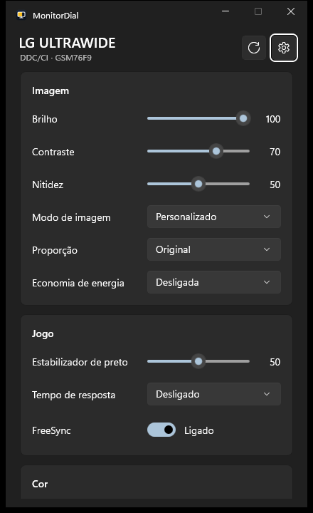
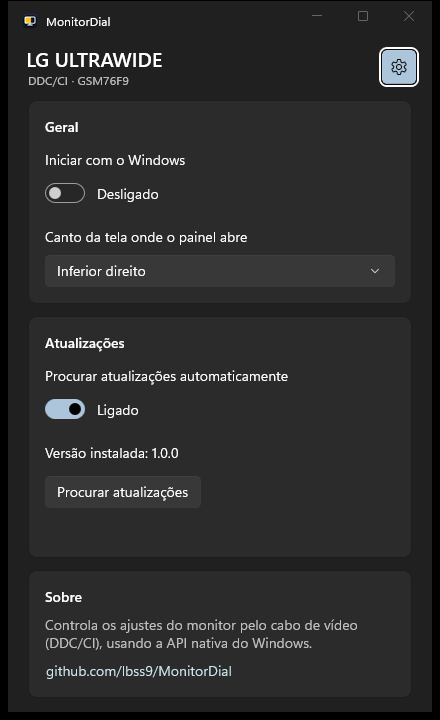

<p align="center">
  
</p>

<h1 align="center">MonitorDial</h1>

<p align="center">
  <strong>Your monitor's on-screen menu, as a tray panel on Windows.</strong><br />
  Brightness, contrast, picture mode, black stabilizer, volume and more, without touching the buttons under the bezel.
</p>

<p align="center">
  <a href="https://github.com/trupper9/MonitorDial/releases/latest">
    
  </a>
  
  
  
  
</p>

<p align="center">
  <a href="#supported-monitors">Supported monitors</a> ·
  <a href="#install">Install</a> ·
  <a href="#controls">Controls</a> ·
  <a href="#how-it-works">How it works</a> ·
  <a href="#build-from-source">Build</a>
</p>

---

<p align="center">
  
  &nbsp;&nbsp;
  
</p>

MonitorDial lives in the system tray. Click the icon and a fixed-size panel opens in the corner of
the screen with every setting your monitor exposes over the video cable. The tray icon is a small
monitor whose screen fills up with the current brightness.

It talks to the monitor with DDC/CI through the Monitor Configuration API that ships with Windows.
There is no driver, no vendor software and no third-party DDC library.

> The interface is in Brazilian Portuguese for now.

## Supported monitors

Short version: **built for and fully tested on the LG 34WK500.** Other DDC/CI monitors get the
standard controls; other LG monitors may also get the LG-specific ones.

| Monitor | Status | What works |
|---|---|---|
| **LG 34WK500** (UltraWide, PnP ID `GSM76F9`) | **Tested.** Every control below was written, read back and restored on real hardware. | Everything listed under [Controls](#controls). |
| Other LG monitors | Untested. | Standard controls should work. The LG-specific controls are shown because they use the same vendor codes on several LG models, but values can differ per model. The app reads each setting back after writing and tells you when the monitor ignored it. |
| Non-LG monitors with DDC/CI | Untested. | Standard controls only (brightness, contrast, sharpness, color temperature, RGB gain, volume, mute). LG-specific controls are hidden. |
| Laptop built-in panels | Not supported. | They do not speak DDC/CI. |

Things that decide whether a monitor works at all:

- **DDC/CI must be enabled** in the monitor's own menu. Most monitors ship with it on.
- **The cable path must carry DDC.** Direct HDMI and DisplayPort do. Some USB-C docks, KVM switches
  and DisplayLink adapters do not.
- **One monitor at a time.** MonitorDial controls the first DDC/CI monitor Windows reports.

If your monitor works (or does not), an issue with the model and what you saw is very welcome.

### Known limits on the LG 34WK500

These were tested and are **not** in the app because the monitor does not allow them over the
standard DDC/CI channel:

- **Input switching.** The monitor ignores the standard input command. LG uses a private I2C source
  address that the Windows API cannot send.
- **Gamma.** The setting can be read, but writes are ignored.
- **Power off / standby** and **factory reset** are left out on purpose.

## Install

1. Download `MonitorDial-win-Setup.exe` from the [latest release](https://github.com/trupper9/MonitorDial/releases/latest).
2. Run it. It installs for the current user only, no administrator rights needed, and starts the app.

The installer is not code-signed, so Windows SmartScreen may ask for confirmation the first time.

The package is self-contained: no .NET or Windows App SDK runtime to install.

To remove it, use **Settings > Apps > Installed apps** in Windows.

## Using it

- **Left-click** the tray icon to open or close the panel.
- **Right-click** for the menu: open, settings, start with Windows, quit.
- Closing or minimizing the panel only hides it. The app keeps running in the tray.
- Hover the tray icon to see the monitor name and current brightness.

### Settings

Open them with the gear button in the panel:

| Setting | What it does |
|---|---|
| Start with Windows | Adds or removes a per-user startup entry. On startup the app goes straight to the tray. |
| Screen corner | Which corner of the screen the panel opens in. |
| Automatic updates | Checks GitHub Releases on launch and every six hours, and shows a tray notification when a new version is out. |
| Check for updates | Checks right now. A new version downloads, installs and restarts the app in one click. |

## Controls

Verified on the LG 34WK500. The VCP code is the DDC/CI feature each control uses.

| Control | VCP | Range | Notes |
|---|---|---|---|
| Brightness | `0x10` | 0 to 100 | |
| Contrast | `0x12` | 0 to 100 | |
| Sharpness | `0x87` | 0 to 100 | |
| Picture mode | `0x15` | Custom, Reader, Photo, Cinema, Color Weakness, FPS Game 1, FPS Game 2, RTS Game, Custom (Game) | LG-specific. Changing the mode changes other settings, so the panel reloads. |
| Aspect ratio | `0xF5` | Wide, Original, Cinema 1, Cinema 2, 1:1 | LG-specific. Cinema 1, Cinema 2 and 1:1 are only accepted while FreeSync is off. |
| Smart energy saving | `0xF6` | Off, Low, High | LG-specific. |
| Black stabilizer | `0xF9` | 0 to 100, steps of 5 | LG-specific. See the quirk below. |
| Response time | `0xF7` | Off, Fast, Normal, Slow | LG-specific. |
| FreeSync | `0xF8` | On, Off | LG-specific. The screen blinks while the monitor resyncs. |
| Color temperature | `0x14` | 6500 K, 9300 K, Custom | |
| Red, green, blue gain | `0x16` `0x18` `0x1A` | 0 to 100 | Changing any of them switches color temperature to Custom. |
| Volume | `0x62` | 0 to 100 | |
| Mute | `0x8D` | On, Off | At volume 0 the monitor reports itself as muted and refuses to unmute. |
| Reset brightness and contrast | `0x05` | | Asks for confirmation. On this monitor it also resets response time and FreeSync. |
| Reset color | `0x08` | | Asks for confirmation. |

### Quirks found along the way

- **Black stabilizer takes 0 to 20, and reports 0 to 100.** Write `10`, read back `50`. Values above
  20 are accepted without an error and silently ignored. MonitorDial does the conversion for you.
- **Toggling FreeSync invalidates the monitor handle.** Windows reconfigures the display, and the
  handle the app was using stops answering. MonitorDial reopens it and carries on.
- **The monitor ignores commands for a moment after a mode change.** The app waits, then reads the
  value back, so the panel always shows what the monitor is really doing.

## How it works

- **DDC/CI** goes through `dxva2.dll`: `GetVCPFeatureAndVCPFeatureReply`, `SetVCPFeature` and
  friends. See [`Ddc.cs`](Ddc.cs).
- **The control list** is a plain table of VCP codes, ranges and labels in [`Controls.cs`](Controls.cs).
  Adding a control is one line.
- **The tray icon** is drawn in code with GDI+ and follows the taskbar's light or dark theme.
  See [`TrayIcon.cs`](TrayIcon.cs).
- **The panel** is WinUI 3 (Windows App SDK), unpackaged.
- **Updates** come from GitHub Releases through [Velopack](https://velopack.io).

### Self-test

The app can test itself against the real monitor. It writes several values to every control, reads
each one back, checks that options meant to be refused are refused, then restores the original
state and verifies it:

```powershell
MonitorDial.exe --selftest report.txt
```

The exit code is 0 when every check passes. On the LG 34WK500 the current build passes 112 of 112.
The screen changes brightness, mode and aspect ratio while it runs, which takes about two minutes.

## Build from source

Requirements: Windows 10 1809 or later and the [.NET 8 SDK](https://dotnet.microsoft.com/download/dotnet/8.0).

```powershell
git clone https://github.com/trupper9/MonitorDial.git
```

```powershell
dotnet build MonitorDial/MonitorDial.csproj -c Release -p:Platform=x64
```

The executable lands in `bin\x64\Release\MonitorDial.exe`.

To build the installer you also need the Velopack CLI (`dotnet tool install -g vpk --version 1.2.0`):

```powershell
pwsh scripts/pack.ps1
```

The app icon is generated by `scripts/New-AppIcon.ps1`.

## Troubleshooting

| Symptom | Likely cause |
|---|---|
| "Nenhum monitor encontrado" (no monitor found) | DDC/CI is off in the monitor menu, or a dock or adapter in the cable path does not pass it through. |
| A control is greyed out | The monitor did not answer when that setting was read. Press the reload button. |
| "O monitor não aplicou..." (the monitor did not apply it) | The monitor accepted the command but kept the old value, usually because another setting blocks it (aspect ratio with FreeSync on, unmute at volume 0). |
| Update check says it only works when installed | You are running a build from the `bin` folder. Updates need the version installed by the setup. |

## License

[MIT](LICENSE)
